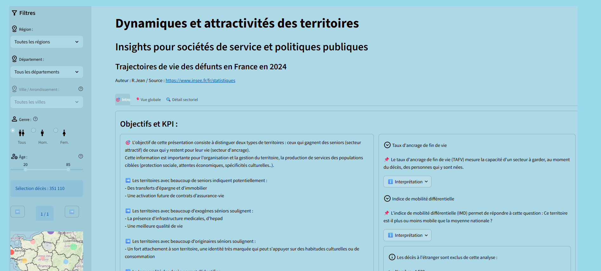
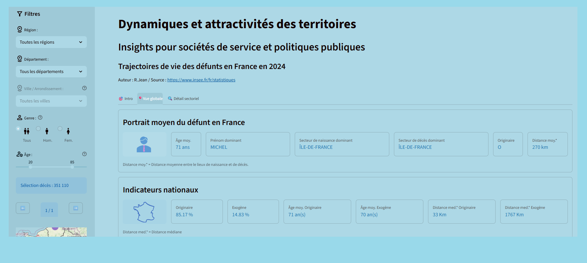
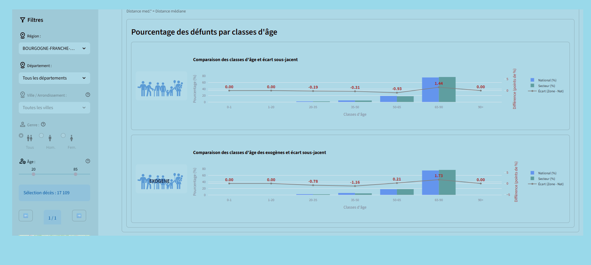
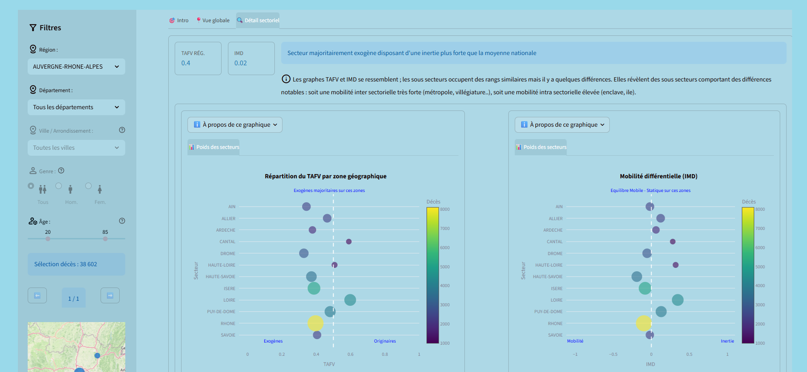
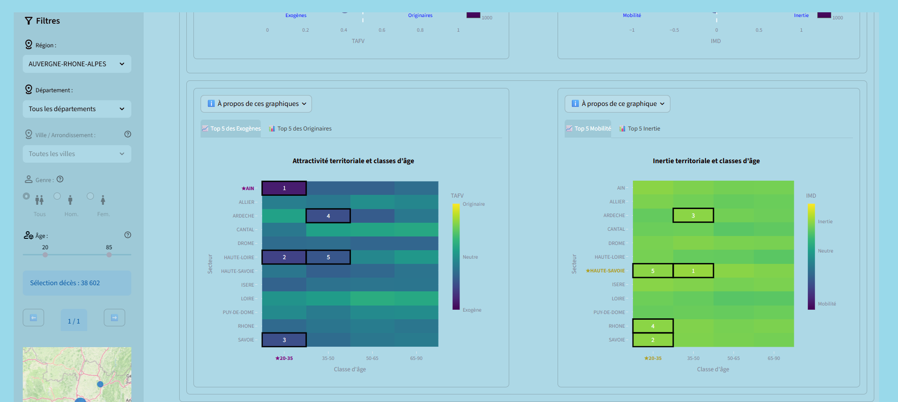
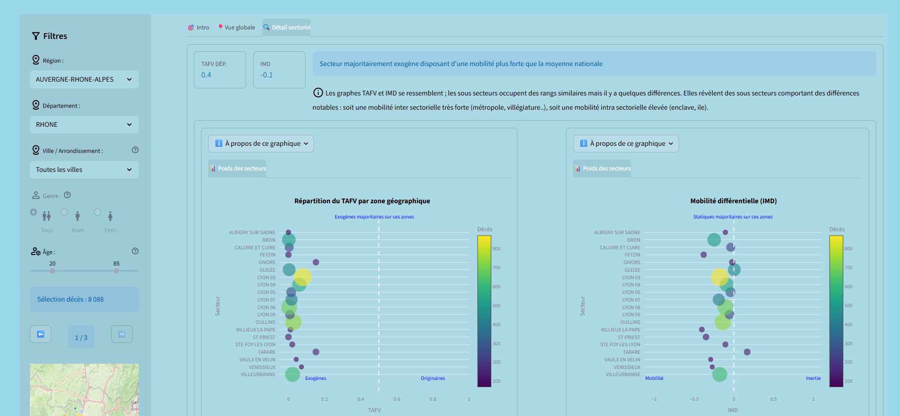
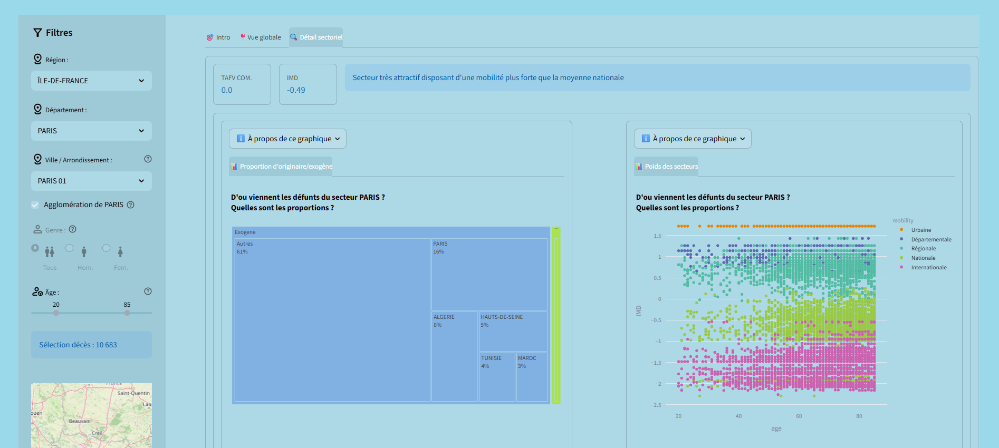
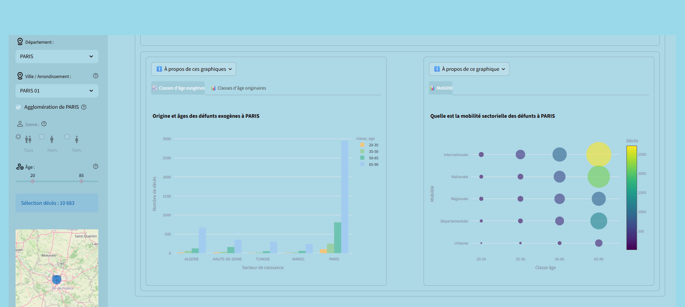

# 🕊️ PROJET DÉCÈS

## 📖 Présentation du projet

L'objectif de ce projet est d'effectuer une analyse des décès en France à partir des données disponibles sur **data.gouv.fr**.

L'étude porte principalement sur deux axes :

1. **Quels territoires gagnent des seniors ?**
2. **Quels territoire proposent une population très ancrée ?**

https://death-people-analysis.streamlit.app/

---

## 🎯 Enjeux et intérêts du projet

L'analyse des données de décès peut permettre d'éclairer certaines prises de décision pour différentes organisations.

### 🛡️ Sociétés d'assurance

Les données peuvent contribuer à mieux comprendre la répartition géographique et temporelle des décès et ainsi participer à des réflexions concernant la fidélisation et l'accompagnement des clients.

### ⚰️ Sociétés de pompes funèbres

L'analyse des données peut permettre d'identifier des périodes de forte activité et d'anticiper certains pics de demandes.

### 🏛️ Pouvoirs publics

Les données peuvent apporter des informations utiles concernant :

* la répartition géographique de la population ;
* les mouvements de population ;
* les évolutions démographiques ;
* la continuité des services publics.

---

# 📊 Sources des données

Les principales données utilisées dans ce projet sont fournies par **data.gouv.fr**, notamment le :

**Fichier des personnes décédées**

[Source : data.gouv.fr](https://www.data.gouv.fr/datasets/fichier-des-personnes-decedees/)

Des données complémentaires concernant les communes françaises, les pays et l'évolution des communes sont également utilisées afin de permettre la correspondance entre les numéros INSEE et les lieux de naissance et de décès.

---

# 🏗️ Architecture du projet

Le projet est organisé autour de plusieurs composants :

```text
_Death_People/
│
├── .streamlit/
│   └── config.toml
│
├── assets/
│   ├── France.svg
│   ├── Paysage.svg
│   ├── Pourcentage.svg
│   ├── Pourcentage_EXO.svg
│   ├── men.svg
│   └── women.svg
│
├── docs/
│   └── source/
│       ├── Extract_Load_People_death_FR.rst
│       ├── Extract_Load_Transform_Commune_FR.rst
│       ├── Transform_People_Death.rst
│       ├── conf.py
│       ├── index.rst
│       ├── modules.rst
│       └── my_module.rst
│
├── my_log/
│   └── DownLoad_File_commune_std.log
│
├── my_module/
│   ├── Cls_graphe_score_pour_viz.py
│   ├── Cls_load_data_pour_viz.py
│   ├── Connexion_Bdd.py
│   ├── Extract_Load_People_death_FR.py
│   ├── Extract_Load_Transform_Commune_FR.py
│   ├── Transform_People_Death.py
│   └── __init__.py
│
├── graphs/
│   ├── graph_bar_month.cpython-313.pyc
│   ├── graph_bar_origine.cpython-313.pyc
│   ├── graph_heat_map.cpython-313.pyc
│   ├── graph_age_TAFV.py
│   ├── graph_scoring.py
│   ├── graph_secteur_score.py
│   ├── graph_secteur_score_TAFV.py
│   ├── graph_secteur_score_age.py
│   └── graph_secteur_score_imd.py
│
├── .gitignore
├── Fichier_Connexion.ini
├── Prj_Death_People_commune_BDD.sql
├── Prj_Death_People_death_people_BDD.sql
└── app.py
```

---

# 🗄️ I. Chargement des lieux

## 1. Chargement des données dans le DWH

Afin de pouvoir analyser les lieux de naissance et de décès, plusieurs fichiers concernant les communes françaises et les pays sont récupérés puis chargés dans le **Data Warehouse PostgreSQL**.

L'objectif est de construire une correspondance permettant d'associer un **numéro INSEE** à un lieu, qu'il s'agisse d'une commune française ou d'un pays.

---

## 📍 Données concernant les communes

### Commune principale

Le fichier principal contient les informations relatives aux communes françaises.

Il contient notamment :

* Numéro INSEE
* Nom de la commune
* Département
* Région
* Latitude
* Longitude
* etc.

Ce fichier n'est cependant pas exhaustif pour certains numéros INSEE. Il est donc complété par d'autres sources.

### Commune 2020 / arrondissement

Ce fichier permet notamment de compléter les informations concernant les arrondissements de certaines communes.

Principales informations :

* Numéro INSEE
* Nom de la commune
* Département
* Région
* etc.

### Communes de Nouvelle-Calédonie

Un fichier spécifique est utilisé pour les communes de Nouvelle-Calédonie.

Il contient notamment :

* Numéro INSEE
* Nom de la commune
* Latitude
* Longitude
* etc.


### Mouvements de communes

Ce fichier permet de prendre en compte les évolutions des communes françaises :

* disparition d'une commune ;
* création d'une commune ;
* modification des codes INSEE ;
* fusion de communes ;
* autres mouvements administratifs.

Le fichier comporte notamment des données hiérarchiques :

* Numéro INSEE avant
* Nom de la commune avant
* Numéro INSEE après
* Nom de la commune après
* Type de mouvement
* etc.

---

## 🌍 Données concernant les pays

Deux fichiers complémentaires sont utilisés pour les pays.

### Pays — Latitude / Longitude

Ce fichier contient notamment :

* Code ISO
* Nom du pays
* Latitude
* Longitude
* etc.

### Pays — INSEE

Ce fichier contient notamment :

* Numéro INSEE
* Nom du pays
* etc.

Les deux fichiers sont fusionnés avant leur chargement dans le DWH.

---

## 🐍 Module de chargement

Le module :

```text
Extract_Load_Transform_Commune_FR.py
```

effectue l'extraction et le chargement des différents fichiers concernant les communes et les pays.

L'objectif est de disposer d'une table permettant d'associer un numéro INSEE à :

* un nom de commune et son département/région lorsqu'il s'agit d'un lieu français ;
* un pays lorsqu'il s'agit d'un lieu étranger.

Une **log de chargement** est également proposée.

---

## 🗃️ Tables créées

Les principales tables créées lors de cette étape sont :

```text
commune_principale
commune_principale_enrichie
commune_mvt
commune_nouvelle_caledonie
Country_cog_lat_lon
```

---

# 🧹 II. Transformation des données communes / pays

Une étape de nettoyage et de transformation est réalisée avant l'utilisation des données.

Elle comprend notamment :

* la suppression des doublons ;
* le formatage des données ;
* la gestion des différents formats ;
* la recherche d'unicité du couple **numéro INSEE / nom**.

Des tables intermédiaires et des CTE sont utilisées pour résoudre les problématiques liées à l'évolution des communes.

---

## 1. Évolution des communes

Une première table permet d'identifier, pour un numéro INSEE donné, le dernier numéro INSEE valide ainsi que le nom de la commune correspondant.

Cette étape est particulièrement importante en raison de la présence de **données hiérarchiques** dans les mouvements de communes.

```text
TABLE : evolution_commune
```

---

## 2. Enrichissement des communes

Une table est construite à partir de la fusion des données principales et de leur enrichissement :

```text
TABLE : commune_principale_et_agglo
```

---

## 3. Fusion communes / Nouvelle-Calédonie / pays

Une nouvelle transformation permet de fusionner :

```text
commune_principale_et_agglo
Country_cog_lat_lon
commune_nouvelle_caledonie
```

Cette étape permet d'obtenir une vision plus complète des différents lieux :

```text
TABLE : commune_principale_et_ncaledonie_pays
```

---

## 4. Prise en compte de l'évolution des communes

Une dernière transformation permet de fusionner les données précédentes avec la table `evolution_commune`.

Le résultat est stocké dans :

```text
TABLE : search_num_insee
```

Cette table constitue une étape importante pour permettre la recherche et l'identification des lieux à partir des numéros INSEE présents dans les données de décès.

Les scripts SQL correspondants sont disponibles dans :

```text
Prj_Death_People_commune_BDD.sql
```

---

# 👥 III. Chargement des données concernant les personnes décédées

Les données relatives aux personnes décédées sont disponibles sur **data.gouv.fr**.

Les fichiers sont publiés :

* par année pour les années précédentes ;
* par trimestre pour l'année en cours.


---

## 1. Identification des fichiers

La première étape consiste à identifier le fichier correspondant à chaque année.

Les URL des différents fichiers sont enregistrées dans le Data Warehouse.

```text
TABLE : nom_url
```

Cette table contient notamment :

| Champ     | Description                  |
| --------- | ---------------------------- |
| `Annee`   | Année des données            |
| `Nom Url` | URL du fichier à télécharger |

Cette étape est réalisée dans le module :

```text
Extract_Load_People_death_FR.py
```

---

## 2. Téléchargement et traitement des fichiers

À partir d'une année sélectionnée, le fichier correspondant est téléchargé.

Une difficulté importante est rencontrée lors du traitement des fichiers `.txt` : certaines données contiennent des **apostrophes**, ce qui peut perturber l'identification correcte des colonnes.

Une étape spécifique est donc nécessaire afin de reconstituer correctement la structure du fichier.

Cette opération est réalisée par la fonction :

```text
traitement_validation
```

Un nettoyage et un formatage des données sont ensuite effectués avant le chargement dans la base.

La fonction principale concernée est :

```text
telechargement_fichier_personne_decedee_selon_annee
```

---

## 🗃️ Table `death_people`

Les données sont finalement chargées dans :

```text
death_people
```

Cette table contient notamment :

* Identifiant de ligne
* Nom
* Prénom
* Sexe
* Date de naissance
* Date de décès
* Numéro INSEE du lieu de naissance
* Numéro INSEE du lieu de décès
* etc.

---

# 🔗 IV. Association des personnes aux lieux

Après le chargement des données de décès, une transformation est nécessaire afin d'obtenir un couple unique de numéros INSEE correspondant aux lieux de naissance et de décès.

Une table intermédiaire est construite à partir de l'identifiant de la personne décédée et des informations relatives aux communes.

```text
TABLE : affectation_insee_site_naissance_death
```

Elle contient notamment :

* Identifiant de ligne
* Numéro INSEE de naissance
* Numéro INSEE de décès
* Latitude du lieu de décès
* Latitude du lieu de naissance
* Région
* etc.

---

## 👁️ Vue `death_people_view`

Une vue regroupant les informations relatives aux personnes et aux lieux est ensuite créée :

```text
VUE : death_people_view
```

Elle permet notamment de retrouver :

* Nom
* Prénom
* Sexe
* Date de naissance
* Date de décès
* Numéro INSEE de naissance
* Numéro INSEE de décès
* Latitude de naissance
* Latitude de décès
* etc.

Cette étape est réalisée à l'aide du script :

```text
Prj_Death_People_death_people_BDD.sql
```

et notamment de la fonction :

```text
Extract_Load_People.creer_base_et_table_personne_decedee
```

---

# 🔄 V. Transformation et analyse

Le module principal consacré à la transformation des données est :

```text
Transform_People_Death.py
```

Il permet de préparer les données nécessaires à l'analyse et à la visualisation.

Cette étape constitue le lien entre les données chargées dans le Data Warehouse et les analyses présentées dans l'application.

---

# 📊 VI. Visualisation

Une application de visualisation est développée avec **Streamlit**.

Le point d'entrée de l'application est :

```text
app.py
```

Les différents graphiques sont regroupés dans le répertoire :

```text
graphs/
```


On y retrouve notamment des traitements permettant de produire :

* des graphiques par mois ;
* des analyses par origine ;
* des cartes de chaleur ;
* des analyses par âge ;
* des scores ;
* des analyses par secteur ;
* des analyses par âge et secteur ;
* des analyses liées à l'IMD.

Le projet aboutit à une application interactive développée avec
**Streamlit**.

Elle permet d'explorer les trajectoires de vie des personnes
décédées en France et de mettre en évidence différents indicateurs
destinés notamment aux sociétés de service et aux politiques
publiques.

L'application est organisée en trois onglets :

- 🎯 **Introduction** : présentation des objectifs et des KPI
- 📍 **Vue globale** : analyse des indicateurs nationaux
- 🔎 **Détail sectoriel** : analyse détaillée des territoires

### 🎯 Introduction



### 📍 Vue globale






### 🔎 Détail sectoriel











---


# 📈 VII. Analyses envisagées

L'analyse finale cherche notamment à répondre aux deux questions principales du projet.

### 🗺️ Répartition géographique des décès

L'objectif est d'étudier la répartition des décès sur le territoire français et de déterminer si celle-ci est homogène ou si certaines zones présentent des concentrations particulières.

### 🏠 Lieu de naissance et lieu de décès

L'objectif est également de comparer le lieu de naissance et le lieu de décès afin d'étudier la mobilité géographique des personnes au cours de leur vie.

Une attention particulière est portée à la proportion de personnes décédant dans leur commune de naissance.

---

# 🛠️ Technologies utilisées

Le projet utilise notamment :

* **Python**
* **PostgreSQL**
* **SQL**
* **Pandas**
* **Streamlit**
* **Git / GitHub**
* **Jupyter / outils Python d'analyse**
* **Sphinx** pour la documentation

---

# 📚 Documentation technique

Une documentation technique est également présente dans le dossier :

```text
docs/source/
```

Elle comprend notamment :

```text
Extract_Load_People_death_FR.rst
Extract_Load_Transform_Commune_FR.rst
Transform_People_Death.rst
```

Cette documentation permet de détailler les différents modules Python du projet.

---

# 📁 Principaux modules Python

| Module                                 | Fonction                                                           |
| -------------------------------------- | ------------------------------------------------------------------ |
| `Extract_Load_People_death_FR.py`      | Extraction et chargement des données de décès                      |
| `Extract_Load_Transform_Commune_FR.py` | Extraction, chargement et transformation des données géographiques |
| `Transform_People_Death.py`            | Transformation des données de décès                                |
| `Connexion_Bdd.py`                     | Gestion de la connexion à la base de données                       |
| `Cls_load_data_pour_viz.py`            | Chargement des données nécessaires aux visualisations              |
| `Cls_graphe_score_pour_viz.py`         | Gestion des scores utilisés pour les visualisations                |
| `app.py`                               | Application Streamlit                                              |

---

# 🗄️ Scripts SQL

Deux scripts SQL principaux sont utilisés :

```text
Prj_Death_People_commune_BDD.sql
```

Gestion de la construction et de la transformation des données relatives aux communes et aux pays.

```text
Prj_Death_People_death_people_BDD.sql
```

Gestion de la construction des tables et vues relatives aux personnes décédées.

---

# ⚠️ Limites et difficultés rencontrées

Plusieurs difficultés techniques ont été rencontrées lors de la réalisation du projet.

### Évolution des communes

Les communes françaises peuvent évoluer au cours du temps : création, disparition, fusion ou modification des codes INSEE.

Il est donc nécessaire de conserver l'historique de ces changements afin de pouvoir interpréter correctement les données anciennes.

### Qualité des fichiers de décès

Les fichiers de décès présentent notamment des problèmes liés à la présence d'apostrophes dans les données textuelles.

Un traitement spécifique a donc été développé afin de reconstruire correctement les colonnes.

### Données géographiques

Les différents fichiers concernant les communes et les pays ne présentent pas toujours la même structure ou le même niveau de détail.

La construction d'une table de correspondance unique constitue donc une étape importante du projet.

---

# 🚀 Lancement du projet

L'application peut être lancée à partir du fichier :

```text
app.py
```

avec Streamlit.

Exemple :

```bash
streamlit run app.py
```

La configuration de Streamlit se trouve dans :

```text
.streamlit/config.toml
```

---

# 👩‍💻 Auteur

**Roselyne JH**

Projet réalisé dans le cadre du projet Data du premier semestre.

---

# 📌 Statut du projet

🚧 Projet d'analyse de données — premier semestre.

Le projet comprend les différentes étapes de la chaîne de traitement :

**Extraction → Nettoyage → Chargement → Transformation → Analyse → Visualisation**
